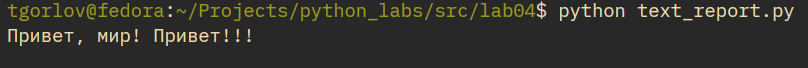
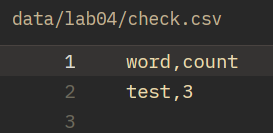
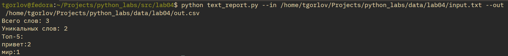
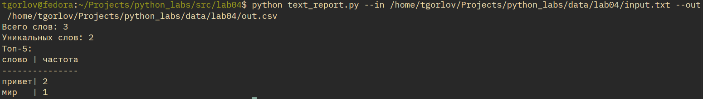
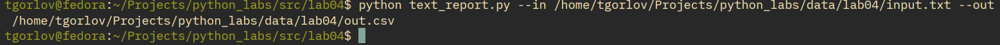
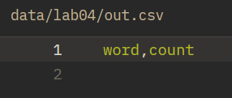
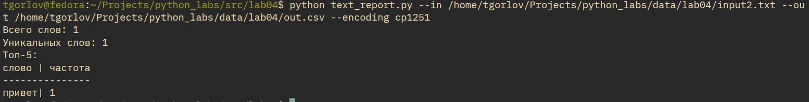
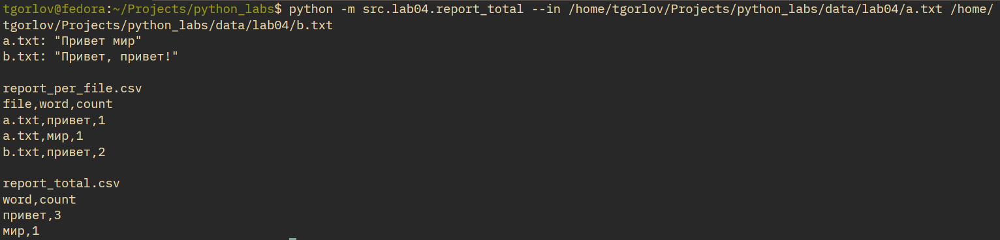
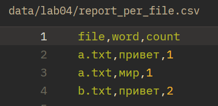
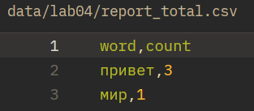

# Лабораторная работа 4
## Задание A
В начале файла `io_txt_csv.py` импортируем следующие библиотеки:
```py
import csv
from collections.abc import Iterable, Sequence
from pathlib import Path
```

### Функция read_text
```py
def read_text(path: str | Path, encoding: str = "utf-8") -> str:
    """
    It reads text from file with choosed encoding.

    Input data
    -----------
    path: str | Path
        Path to file.
    encoding = "utf-8": str
        Choosed encoding. You can choose another encoding, for example: encoding="cp1251".

    Returns
    -------
    Text from file.
        Type: str

    Exceptions
    ----------
    FileNotFoundError
    UnicodeDecodeError
    """
    p = Path(path)
    return p.read_text(encoding=encoding)
```

### Функция ensure_parent_dir
```py
def ensure_parent_dir(path: str | Path) -> None:
    """
    Creates parent directory for file if it wasn't.

    Input data
    -----------
    path: str | Path
        Full path to file!

    Returns
    -------
    None
    """
    Path(path).parent.mkdir(parents=True, exist_ok=True)
```

### Функция write_csv
```py
def write_csv(rows: Iterable[Sequence], path: str | Path,
    header: tuple[str, ...] | None = None) -> None:
    """
    It writes CSV-table with header and rows by path.
    Output file will contain only header if input rows is empty.

    Input data
    -----------
    rows: Iterable[Sequence]
    path: str | Path
        Path to file.
    header: tuple[str, ...] | None = None

    Returns
    -------
    None

    Exceptions
    ----------
    ValueError: rows must be similar length.
    """
    p = Path(path)

    ensure_parent_dir(path)

    rows = list(rows)
    with p.open("w", newline="", encoding="utf-8") as f:
        w = csv.writer(f)
        if header is not None:
            w.writerow(header)
            if len(rows) != 0:
                if len(rows[0]) != len(header):
                    raise ValueError("rows must be similar length.")

                for r in range(len(rows)):
                    if len(rows[r]) == len(rows[0]):
                        w.writerow(rows[r])
                    else:
                        raise ValueError("rows must be similar length.")
```

## Задание B и C
Для смены вида вывода в консоль с обычного на табличный и наоборот требуется поменять значение перменной `TABLE_MODE`.
```py
import argparse
from collections import Counter

from src.lab04.io_txt_csv import ensure_parent_dir, read_text, write_csv
from src.lib.text import count_freq, normalize, tokenize, top_n


def frequencies_from_text(text: str) -> dict[str, int]:
    tokens = tokenize(normalize(text))
    return Counter(tokens)

def sorted_word_counts(freq: dict[str, int]) -> list[tuple[str, int]]:
    return sorted(freq.items(), key=lambda kv: (-kv[1], kv[0]))

def args_parse():
    parser = argparse.ArgumentParser()

    parser.add_argument(
         "--in", "-i",
        dest="input_file",
        required=True
    )
    parser.add_argument(
         "--out", "-o",
        dest="out_file",
        required=True
    )
    parser.add_argument(
         "--encoding", "-e",
        dest="encoding",
        default="utf-8",
        required=False
    )
    return parser.parse_args()

def main():
    args = args_parse()
    text = read_text(args.input_file, encoding=args.encoding)
    nrm_text = normalize(text)
    tokens = tokenize(nrm_text)
    freqs = dict(sorted_word_counts(count_freq(tokens)))

    ensure_parent_dir(args.out_file)
    write_csv(freqs.items(), args.out_file, header=("word", "count"))

    if text != "":
        TABLE_MODE = False

        top_5 = top_n(freqs, 5)

        print(f"Всего слов: {len(tokens)}\nУникальных слов: {len(freqs.keys())}\nТоп-5:")

        if TABLE_MODE:
            max_len = max(len(k) for k in freqs)

            print(f"{"слово":<{max_len}}| частота")
            print("-"*( max_len + 9 ))

            for item in top_5:
                w, f = item
                print(f"{w:<{max_len}}| {f}")
        else:
            for item in top_5:
                w, f = item
                print(f"{w}:{f}")

if __name__ == "__main__":
    main()
```

### Мини-тесты
```py
from io_txt_csv import read_text, write_csv

txt = read_text("../../data/lab04/input.txt")  # должен вернуть строку
print(txt)
write_csv([("word","count"),("test",3)], "../../data/lab04/check.csv")  # создаст CSV
```
|  |
| :--: |
| Рис 1. Мини-тесты read_text и write_csv |

|  |
| :--: |
| Рис 2. Содержимое check.csv |

## Задание D
```py
import argparse
from collections import Counter
from pathlib import Path

from src.lab04.io_txt_csv import read_text, write_csv
from src.lib.text import count_freq, normalize, tokenize


def frequencies_from_text(text: str) -> list [str]:
    """
    Returns tokens from input text

    Input data
    ----------
    text: str
        Input text.

    Returns
    -------
    Return list of tokens.
    """
    tokens = tokenize(normalize(text))
    return tokens

def ru_key(s: str) -> tuple:
    """
    Returns key for correct sorting with russian characters.

    Input data
    ----------
    s: str
        Input text.

    Returns
    -------
    Return tuple.
    """
    _RU_ALPHABET = "абвгдеёжзийклмнопрстуфхцчшщъыьэюя"
    _RU_ORDER = {ch: i for i, ch in enumerate(_RU_ALPHABET)}
    result = []
    for ch in s:
        if ch in _RU_ORDER:
            result.append((0, -_RU_ORDER[ch]))
        else:
            result.append((1, -ord(ch)))
    return tuple(result)

def build_per_file_rows(paths: list[str], encoding: str = "utf-8") -> list[tuple[str, str, int]]:
    """
    It returns strings for report for every file.
    Sorted: file ↑, count ↓, word ↑.

    Input data
    -----------
    paths: list[Path]
    encoding: str = "utf-8"

    Returns
    -------
    list[tuple[str, str, int]]
    """
    rows: list[tuple[str, str, int]] = []

    for p in paths:
        text = read_text(p, encoding=encoding)
        counter = count_freq(frequencies_from_text(text))

        for word, count in counter.items():
            rows.append((Path(p).name, word, count))

        print(f"{Path(p).name}: \"{text.strip()}\"")

    rows.sort(key=lambda r: (r[0], -r[2], ru_key(r[1])))
    return rows


def build_total_rows(paths: list[str], encoding: str = "utf-8") -> list[tuple[str, int]]:
    """
    It returns list for total report.
    Sorted: count ↓, word ↑.

    Input data
    ----------
    paths: list[Path],
    encoding: str = "utf-8"

    Returns
    -------
    list[tuple[str, int]]
    """
    total: Counter = Counter()

    for p in paths:
        text = read_text(p, encoding=encoding)
        total.update(frequencies_from_text(text))

    rows = [(word, count) for word, count in total.items()]
    rows.sort(key=lambda r: (-r[1], ru_key(r[0])))
    return rows


def main():
    parser = argparse.ArgumentParser()
    parser.add_argument(
        "--in",
        dest="inputs",
        nargs="+",
        required=True
    )
    parser.add_argument(
        "--encoding",
        default="utf-8",
        required=False
    )
    args = parser.parse_args()

    per_file_rows = build_per_file_rows(args.inputs, args.encoding)
    per_file_path = "../../data/lab04/report_per_file.csv"

    write_csv(per_file_rows, per_file_path, header=("file", "word", "count"))

    total_rows = build_total_rows(args.inputs, args.encoding)
    total_path = "../../data/lab04/report_total.csv"

    write_csv(total_rows, total_path, header=("word", "count"))

    print()

    with open(per_file_path, "r", encoding="utf-8") as f:
        print("report_per_file.csv")
        print(f.read().strip())

    print()

    with open(total_path, "r", encoding="utf-8") as f:
        print("report_total.csv")
        print(f.read().strip())

if __name__ == "__main__":
    main()
```

## Тест-кейсы
### Для задания A
#### Базовый вывод
|  |
| :--: |
| Рис 3. Тест-кейса для A, базовый вывод |
#### Табличный вывод в консоль
|  |
| :--: |
| Рис 4. Тест-кейса для A, табличный вывод |
### Для задания B и C
#### Пустой файл
|  |
| :--: |
| Рис 5. Пустой вывод для пустого файла |

|  |
| :--: |
| Рис 6. Выходной CSV-файл для пустого входного |
#### Нестандартная кодировка
Входной файл: `input2.txt`

Кодировка: `cp1251`

|  |
| :--: |
| Рис 7. Чтение файла с нестандартной кодировкой |

### Для задания D
|  |
| :--: |
| Рис 8. Результат сбора статистики по нескольким файлами |

|  |
| :--: |
| Рис 9. Файл report_per_file.csv |

|  |
| :--: |
| Рис 10. Файл report_total.csv |
