# Лабораторная работа 5
## Задание A
```py
import csv
import json


def json_to_csv(json_path: str, csv_path: str) -> None:
    """
    Read JSON-file and convert to CSV-file.

    Input data
    ----------
    json_path: str
    csv_path: str

    Returns
    -------
    None

    Raises
    ------
    ValueError: JSON-file is empty or invalid structure.
    ValueError: JSON isn't list of dicts.
    """
    with open(json_path, "r", encoding="utf-8") as f:
        try:
            data: list [dict] = json.load(f)
        except json.decoder.JSONDecodeError:
            raise ValueError("JSON-file is empty or invalid structure.")

        header = data[0].keys()

        with open(csv_path, "w", newline="", encoding="utf-8") as f:
            try:
                w = csv.DictWriter(f, fieldnames=header)
                w.writeheader()
                w.writerows(data)
            except ValueError:
                raise ValueError("JSON-file is empty or invalid structure.")
            except AttributeError:
                raise ValueError("JSON isn't list of dicts.")

def csv_to_json(csv_path: str, json_path: str) -> None:
    """
    Read CSV-file and convert to JSON-file.

    Input data
    ----------
    csv_path: str
    json_path: str

    Returns
    -------
    None

    Raises
    ------
    ValueError: CSV-file is empty or invalid structure.
    """

    with open(csv_path, "r", encoding="utf-8") as f:
        # Get information about CSV-file

        sample = f.read(1024)
        try:
            dialect = csv.Sniffer().sniff(sample)
        except csv.Error:
            raise ValueError("CSV-file is empty or invalid structure.")

        f.seek(0)
        reader = csv.DictReader(f, dialect=dialect)

        data = list(reader)

        if reader.fieldnames == []:
            raise ValueError("CSV-file is empty or invalid structure.")

        with open(json_path, "w", encoding="utf-8") as f:
            json.dump(data, f, ensure_ascii=False, indent=2)
```
### Проверки
Для запуска: `python -m src.lab05.json_csv`
**1. Тест функциональности json_to_csv.**

`data/lab05/samples/people.csv` --> `data/lab05/out/people.csv`
```py
json_to_csv("data/lab05/samples/people.json", "data/lab05/out/people.csv")
```
| 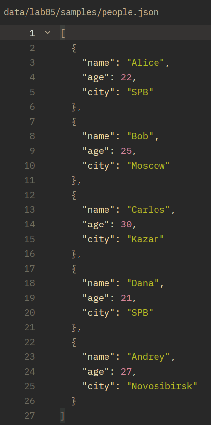 |
| :--: |
| Рис 1. Вход people.json |

| 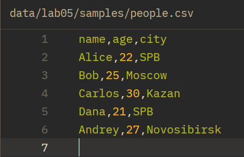 |
| :--: |
| Рис 2. Выход people.json |

**2. Пустой JSON**

```py
json_to_csv("data/lab05/samples/people.json", "data/lab05/out/people.csv")
```

| 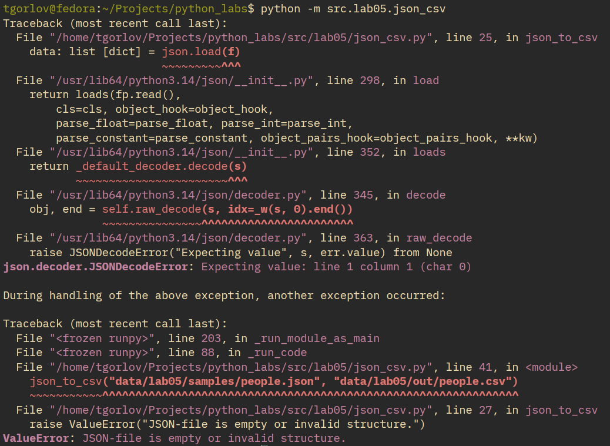 |
| :--: |
| Рис 3. При чтении пустого JSON |

**3. JSON-файла не существует**

```py
json_to_csv("data/lab05/samples/people666.json", "data/lab05/out/people.csv")
```

| 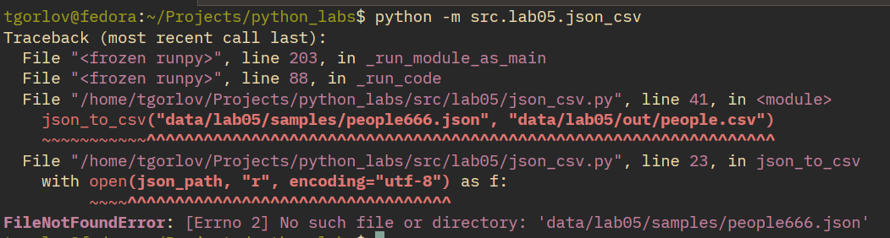 |
| :--: |
| Рис 4. При чтении несуществующего файла |

**3. JSON-файл не соотвествует формату**

```py
json_to_csv("data/lab05/samples/people.json", "data/lab05/out/people.csv")
```

Введем следующий JSON-файл, в котором у некторых элементов нет параметра `city`.
```json
[
  {
    "name": "Alice",
    "age": 22
  },
  {
    "name": "Bob",
    "age": 25
  },
  {
    "name": "Carlos",
    "age": 30,
    "city": "Kazan"
  },
  ...
]
```

| 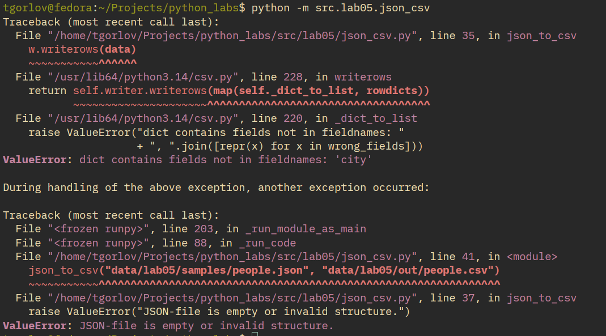 |
| :--: |
| Рис 5. При чтении неправильного файла |

**4. CSV-файл не существует**

```py
csv_to_json("data/lab05/samples/people666.csv", "data/lab05/out/people.json")
```

| 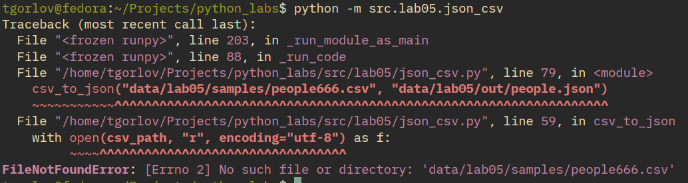 |
| :--: |
| Рис 6. При чтении несуществующего файла |

**4. CSV-файл пустой**

```py
csv_to_json("data/lab05/samples/people.csv", "data/lab05/out/people.json")
```

| 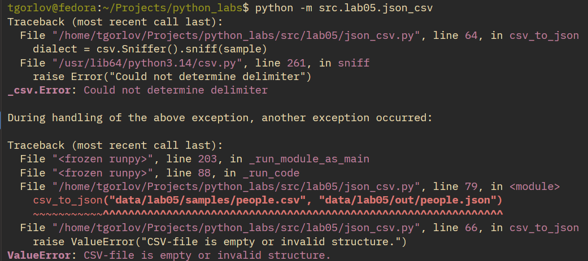 |
| :--: |
| Рис 7. При чтении пустого файла |

**4. CSV-файл неправильного формата**

```py
csv_to_json("data/lab05/samples/people.csv", "data/lab05/out/people.json")
```
К примеру, введем таблицу с отсуствующим заголовком у 3 столбца.
```csv
name,age
Alice,22,SPB
Bob,25,Moscow
Carlos,30,Kazan
Dana,21,SPB
Andrey,27,Novosibirsk
```

| 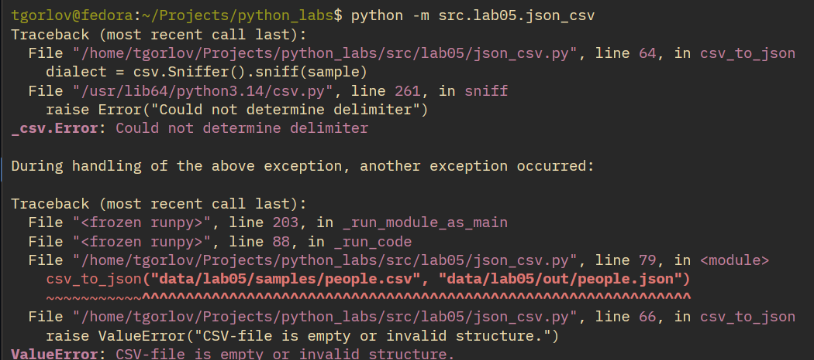 |
| :--: |
| Рис 8. При чтении неправильного файла |

## Задание B
```py
import csv

from openpyxl import Workbook
from openpyxl.utils import get_column_letter


def csv_to_xlsx(csv_path: str, xlsx_path: str) -> None:
    """
    Read CSV-file and convert to XLSX-file.

    Input data
    ----------
    csv_path: str
    xlsx_path: str

    Returns
    -------
    None

    Raises
    ------
    ValueError: CSV-file is empty or invalid structure.
    """
    wb = Workbook()
    ws = wb[wb.sheetnames[0]]
    ws.title = "Sheet1"
    wb.active = 0

    with open(csv_path, "r", encoding="utf-8", newline="") as f:
        # Get information about CSV-file
        sample = f.read(1024)
        try:
            dialect = csv.Sniffer().sniff(sample)
        except csv.Error:
            raise ValueError("CSV-file is empty or invalid structure.")

        f.seek(0)
        reader = csv.reader(f, dialect=dialect)

        max_len = []
        for row_idx, row in enumerate(reader, start=1):
            for col_idx, value in enumerate(row, start=1):
                ws.cell(row=row_idx, column=col_idx, value=value)

                if col_idx > len(max_len):
                    max_len.append(0)
                max_len[col_idx - 1] = max(max_len[col_idx - 1], len(str(value)))

    # Autowidth (min = 8)
    for i, length in enumerate(max_len, start=1):
        ws.column_dimensions[get_column_letter(i)].width = max(length, 8)

    wb.save(xlsx_path)
```

### Проверки
Для запуска: `python -m src.lab05.csv_xlsx`
**1. Проверка функциональности**
```py
csv_to_xlsx("data/lab05/samples/cities.csv", "data/lab05/out/cities.xlsx")
```

| 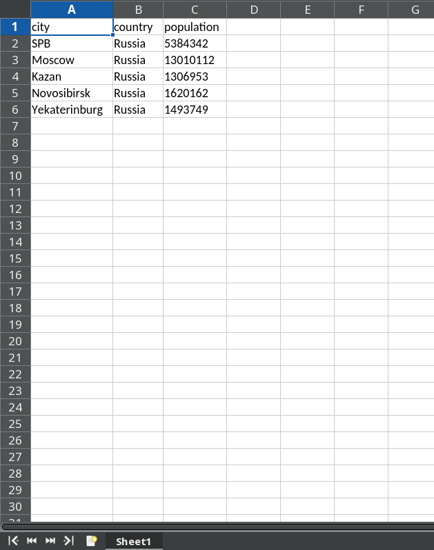 |
| :--: |
| Рис 9. Выходной XLSX-файл |

**2. Несуществующий файл**
```py
csv_to_xlsx("data/lab05/samples/cities666.csv", "data/lab05/out/cities.xlsx")
```

| 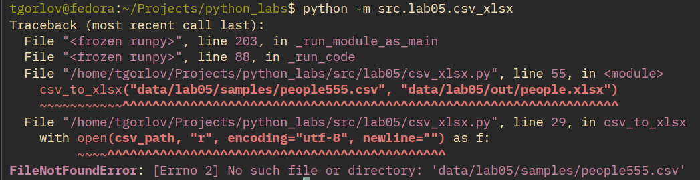 |
| :--: |
| Рис 10. Несуществующий файл на входе |

**2. Пустой файл**
```py
csv_to_xlsx("data/lab05/samples/cities.csv", "data/lab05/out/cities.xlsx")
```

| 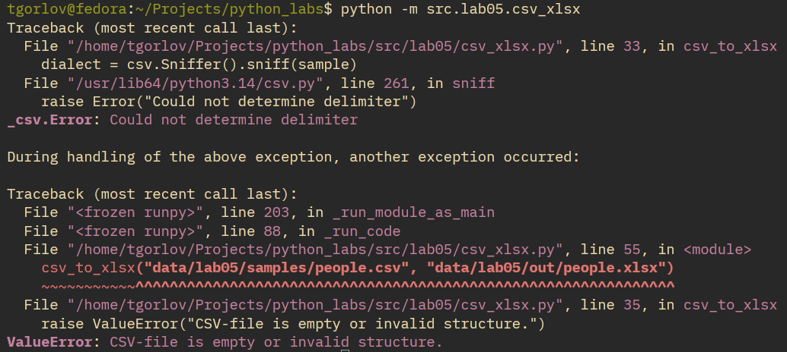 |
| :--: |
| Рис 11. Пустой файл на входе |

**2. Неправильный файл**
Снова уберем заголовок у третьей колонки.
```csv
city,country,
SPB,Russia,5384342
Moscow,Russia,13010112
Kazan,Russia,1306953
Novosibirsk,Russia,1620162
Yekaterinburg,Russia,1493749
```

```py
csv_to_xlsx("data/lab05/samples/cities.csv", "data/lab05/out/cities.xlsx")
```

| 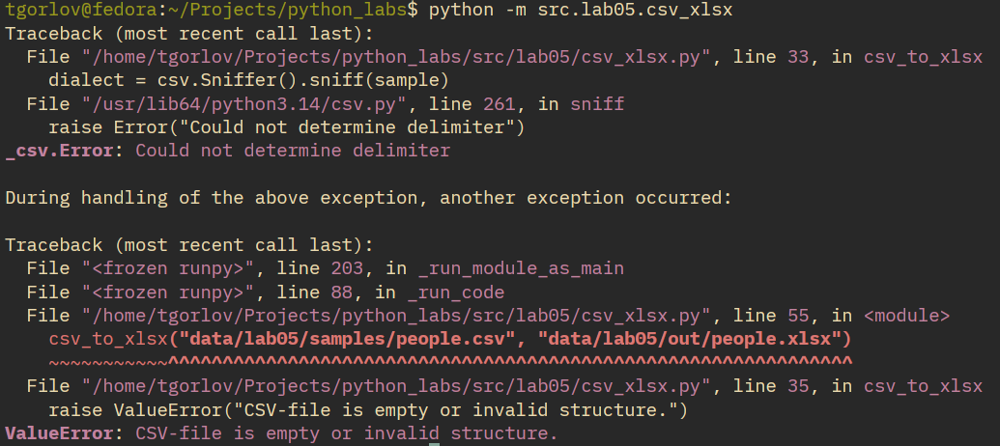 |
| :--: |
| Рис 12. Неправильный файл на входе |
