# Лабораторная работа 6
## Задание 1 (cli_text.py)
### Тест-кейсы
```py
import argparse

from src.lab04.io_txt_csv import read_text
from src.lab04.text_report import sorted_word_counts
from src.lib.text import *


def main():
    parser = argparse.ArgumentParser(description="CLI‑utils for lab №6")
    subparsers = parser.add_subparsers(dest="command")

    cat_parser = subparsers.add_parser("cat", help="Print lines from file.")
    cat_parser.add_argument(
        "--input",
        dest="input_file",
        required=True
    )
    cat_parser.add_argument("-n", action="store_true", help="Numurate strings.")

    stats_parser = subparsers.add_parser("stats", help="Freqs of words")
    stats_parser.add_argument(
        "--input",
        dest="input_file",
        required=True,
        help="Input path."
    )
    stats_parser.add_argument(
        "--top",
        dest="top_n",
        required=False,
        type=int,
        default=5,
        help="Count of top tokens. Default: 5."
    )

    args = parser.parse_args()

    if args.command == "cat":
        with open(args.input_file, "r", encoding="utf-8") as f:
            for c, l in enumerate(f.readlines()):
                if args.n:
                    print(f"[{c}]", l, end="")
                else:
                    print(l, end="")

    elif args.command == "stats":
        text = read_text(args.input_file, encoding="utf-8")
        nrm_text = normalize(text)
        tokens = tokenize(nrm_text)
        freqs = dict(sorted_word_counts(count_freq(tokens)))

        if text != "":
            top_5 = top_n(freqs, args.top_n)

            print(f"Всего слов: {len(tokens)}\nУникальных слов: {len(freqs.keys())}\nТоп-5:")

            max_len = max(len(k) for k in freqs)

            print(f"{"слово":<{max_len}}| частота")
            print("-"*( max_len + 9 ))

            for item in top_5:
                w, f = item
                print(f"{w:<{max_len}}| {f}")

if __name__ == "__main__":
    main()
```
| 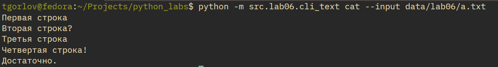 |
| :--: |
| Рис 1. Работа cat |

| 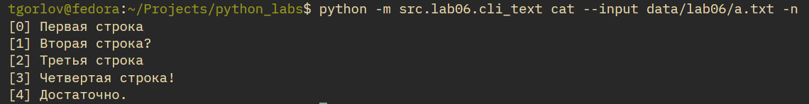 |
| :--: |
| Рис 2. Работа cat c нумерацией |

| 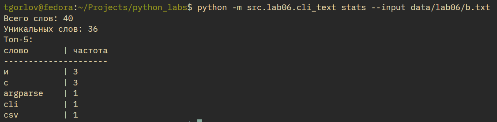 |
| :--: |
| Рис 3. Работа stats |

| 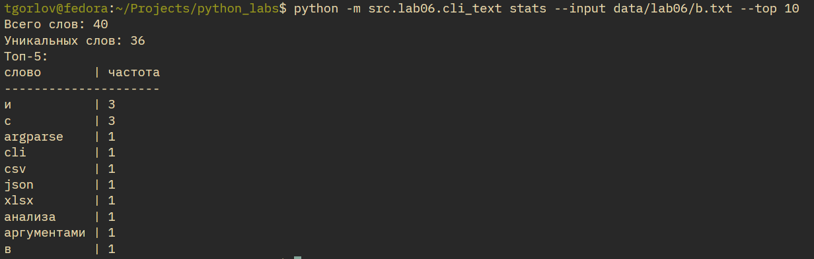 |
| :--: |
| Рис 4. Работа stats с другим количеством топ-токенов |

### Подсказки помощи
| 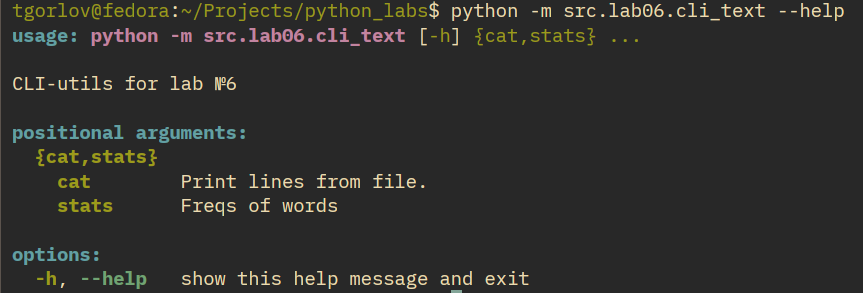 |
| :--: |
| Рис 5. Подсказки к cli_text |

| 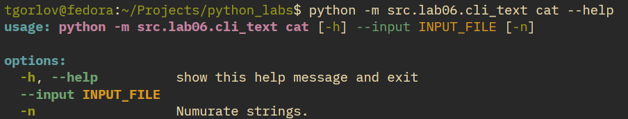 |
| :--: |
| Рис 6. Подсказки к cli_text cat |

| 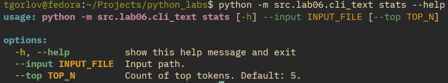 |
| :--: |
| Рис 7. Подсказки к cli_text stats |

## Задание 2 (cli_convert.py)
```py
import argparse

from src.lab05.csv_xlsx import csv_to_xlsx
from src.lab05.json_csv import csv_to_json, json_to_csv


def main():
    parser = argparse.ArgumentParser(description="Collection of data converters.")
    sub = parser.add_subparsers(dest="command")

    p1 = sub.add_parser("json2csv", help="Convert JSON-file to CSV-file.")
    p1.add_argument("--in", dest="input", required=True, help="")
    p1.add_argument("--out", dest="output", required=True, )

    p2 = sub.add_parser("csv2json", help="Convert CSV-file to JSON-file.")
    p2.add_argument("--in", dest="input", required=True)
    p2.add_argument("--out", dest="output", required=True)

    p3 = sub.add_parser("csv2xlsx", help="Convert CSV-file to XLSX-file.")
    p3.add_argument("--in", dest="input", required=True)
    p3.add_argument("--out", dest="output", required=True)

    args = parser.parse_args()

    if args.command == "json2csv":
        json_to_csv(args.input, args.output)

    elif args.command == "csv2json":
        csv_to_json(args.input, args.output)

    elif args.command == "csv2xlsx":
        csv_to_xlsx(args.input, args.output)

if __name__ == "__main__":
    main()
```

### Подсказки
| 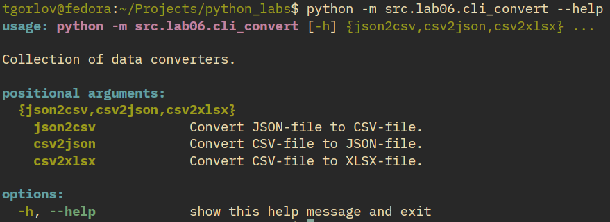 |
| :--: |
| Рис 8. Подсказки к cli_convert общая информация |

| 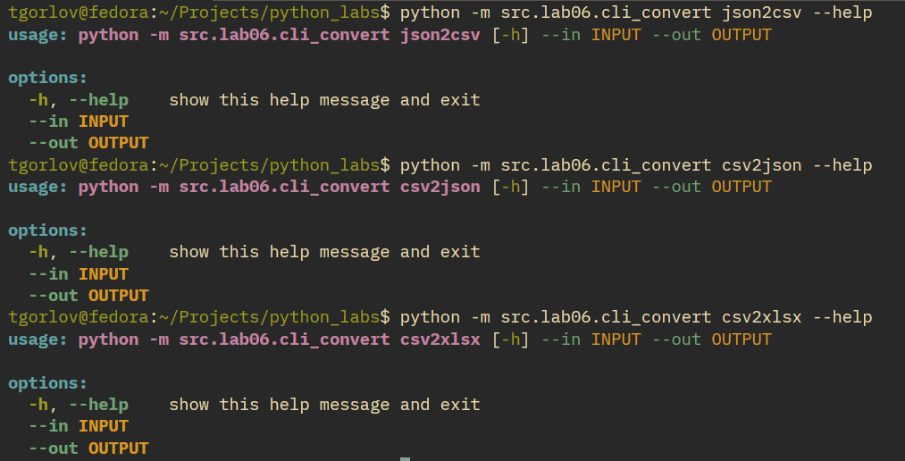 |
| :--: |
| Рис 9. Подсказки к cli_convert по всем функциям |

### Тест-кейсы
#### json2csv

| 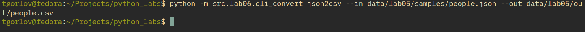 |
| :--: |
| Рис 10. Запуск json2csv |

| 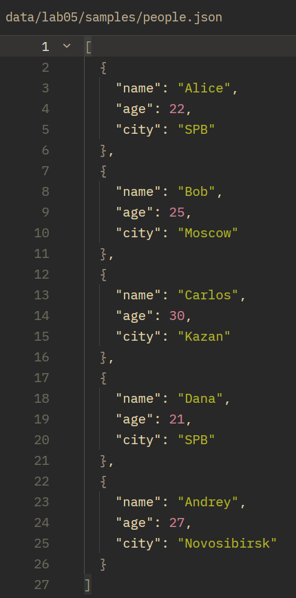 |
| :--: |
| Рис 11. Вход people.json |

| 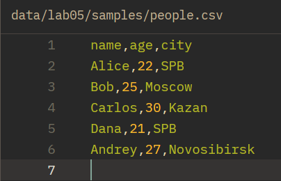 |
| :--: |
| Рис 12. Выход people.json |

#### csv2json

| 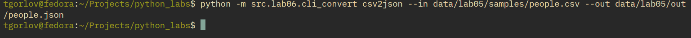 |
| :--: |
| Рис 13. Запуск csv2json |

| 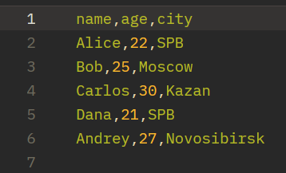 |
| :--: |
| Рис 14. Входной файл |

| 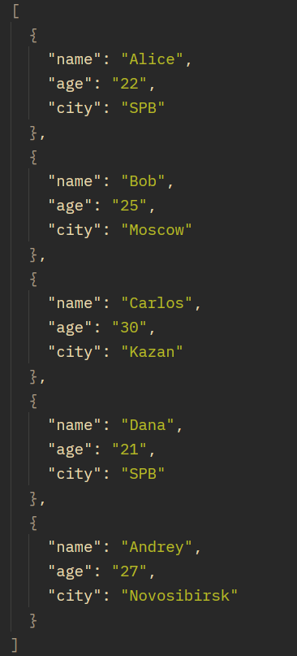 |
| :--: |
| Рис 15. Выходной файл |

#### csv2xlsx

| 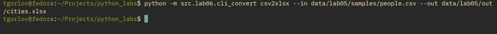 |
| :--: |
| Рис 16. Запуск csv2xlsx |

| 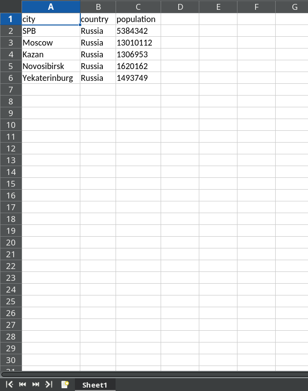 |
| :--: |
| Рис 18. Выходной XLSX-файл |

## Проверки на оишбки
### Пример несуществующего файла

| 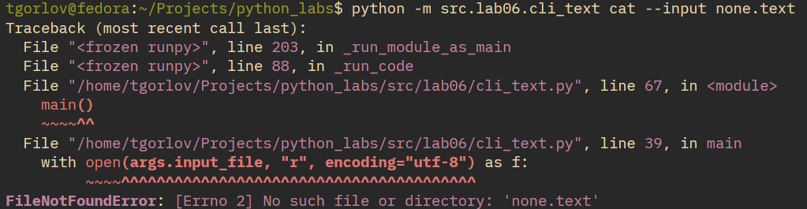 |
| :--: |
| Рис 18. Ошибка несуществующего файла |

### Пример неправильного аргумента

| 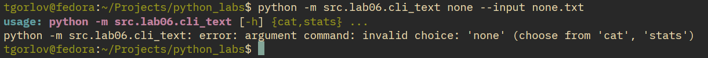 |
| :--: |
| Рис 19. Ошибка неправильного аргумента |
