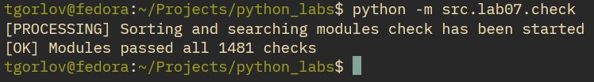
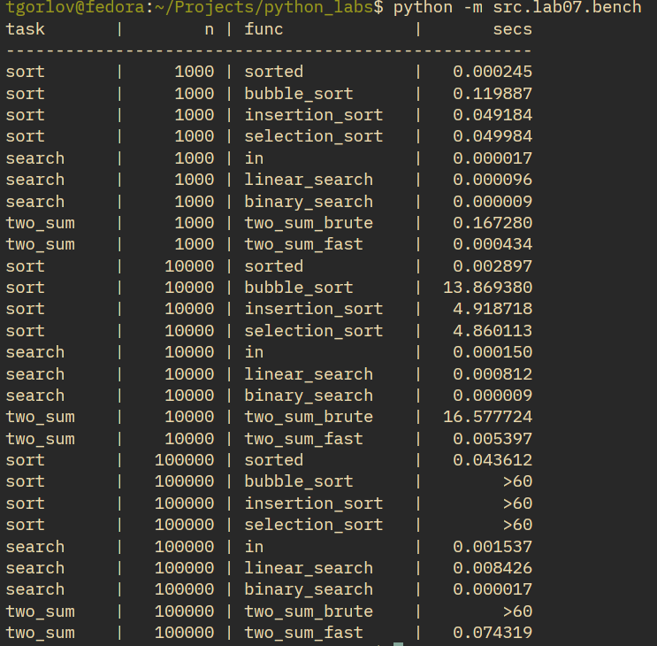
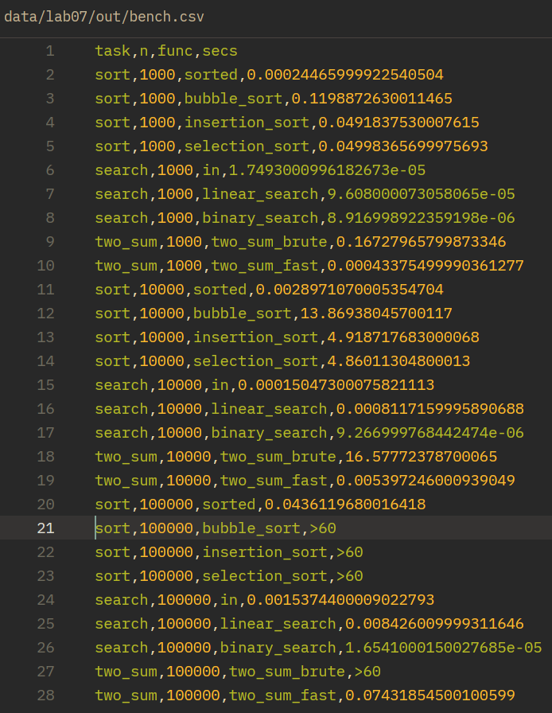

# Лабораторная работа 7
## Сортировки
```py
def bubble_sort(nums):
    """
    Bubble sorting function. / O(n^2)

    Input data
    ----------
    nums
        Array of numbers.

    Returns
    -------
    New ascending order sorted array.
    """
    arr = nums.copy()
    n = len(arr)
    change = False

    for i in range(n - 1):
        for j in range(n - 1 - i):
            if arr[j] > arr[j+1]:
                arr[j], arr[j+1] = arr[j+1], arr[j]
                change = True
        if not change:
            # Exit early if array is already sorted
            break
    return arr

def insertion_sort(nums):
    """
    Insertion sorting function. / O(n^2)

    Input data
    ----------
    nums
        Array of numbers.

    Returns
    -------
    New ascending order sorted array.
    """
    arr = nums.copy()

    for i in range(1, len(arr)):
        num = arr[i]
        j = i - 1

        while j >= 0 and arr[j] > num:
            arr[j + 1] = arr[j]
            j -= 1

        arr[j + 1] = num

    return arr


def selection_sort(nums):
    """
    Selection sorting function. / O(n^2)

    Input data
    ----------
    nums
        Array of numbers.

    Returns
    -------
    New ascending order sorted array.
    """
    arr = nums.copy()

    for i in range(len(arr)):
        min_pos = i
        for j in range(i + 1, len(arr)):
            if arr[j] < arr[min_pos]: min_pos = j
        arr[i], arr[min_pos] = arr[min_pos], arr[i]

    return arr
```

## Поиск
```py
from tabnanny import check


def linear_search(nums, x) -> int:
    """
    Linear search x in nums and returns index of element. Returns -1 if it wasn't find.

    Input data
    ----------
    nums:
        Array of nums.
    x:
        Searching element.

    Returns
    -------
    First founded index of element or -1.
    """
    for i in range(len(nums)):
        if nums[i] == x:
            return i

    return -1


def binary_search(sorted_nums, x) -> int:
    """
    Binary search in ascending order sorted array. / O(log(n))

    Input data
    ----------
    sorted_nums:
        Ascending order sorted array.
    x:
        Searching element.

    Returns
    -------
    First founded index of element or -1.
    """
    l = 0
    r = len(sorted_nums) - 1

    while l <= r:
        mid = (l+r)//2

        if sorted_nums[mid] == x:
            return mid
        elif sorted_nums[mid] < x:
            l = mid + 1
        else:
            r = mid - 1

    return -1

def two_sum_brute(nums, target) -> tuple[int, int] | None:
    """
    Find pair with sum of elements equals targt value and returns it. It returns None, if array hasn't such pair. / O(n^2)

    Input data
    ----------
    nums:
        Array of numbers.
    target:
        Target sum of pair.

    Returns
    -------
    Pair of elements.
        tuple[int, int] | None
    """
    n = len(nums)

    for i in range(n):
        for j in range(n):
            if i != j:
                x = nums[i]
                y = nums[j]
                if x + y == target:
                    return x, y

def two_sum_fast(nums, target) -> tuple[int, int] | None:
    """
    Fast algorithm for finding pair with sum of elements equals targt value. It returns None, if array hasn't such pair. / O(n)

    Input data
    ----------
    nums:
        Array of numbers.
    target:
        Target sum of pair.

    Returns
    -------
    Pair of elements.
        tuple[int, int] | None
    """
    checked = {}

    for i, num in enumerate(nums):
        need = target - num

        if need in checked:
            return checked[need], i

        checked[num] = i

    return None
```

## Тесты
```py
import random

from src.lab07.search import binary_search, linear_search, two_sum_brute, two_sum_fast
from src.lab07.sorting import bubble_sort, insertion_sort, selection_sort


def check_sorting(fn, trials=100) -> int:
    """
    Check sorting function with random data.

    Input data
    ----------
    fn:
        Callable object of function.
    trials = 100:
        Trials of checking.

    Returns
    -------
    Returns count of sucsesfully checks.
    """
    checks = 0
    for _ in range(trials):
        length = random.randint(0, 50)
        nums = [random.randint(-100, 100) for _ in range(length)]
        original = nums.copy()

        res = fn(nums)
        assert res == sorted(original), f"Error in sorting {fn.__name__}: {res} != {sorted(original)}"
        assert nums == original, f"has been {fn.__name__}"
        checks += 1

    return checks


def check_search(trials=100) -> int:
    """
    Checks linear and binary search include extremes and absents values.

    Input data
    ----------
    trials = 100:
        Trials of checking.

    Returns
    -------
    Returns count of sucsesfully checks.
    """
    checks = 0

    for _ in range(trials):
        length = random.randint(0, 50)
        nums = [random.randint(-100, 100) for _ in range(length)]

        # Peek candidates from nums for searching include extremes and absents
        candidates = [-110, 110]
        if nums:
            candidates.extend([nums[0], nums[-1], random.choice(nums)])

        for x in candidates:
            res_lin = linear_search(nums, x)
            try:
                expected_idx = nums.index(x)
            except ValueError:
                expected_idx = -1

            assert res_lin == expected_idx, f"linear_search({nums}, {x}) -> {res_lin}, expected {expected_idx}"
            checks += 1

        sorted_nums = sorted(nums)
        for x in candidates:
            res_bin = binary_search(sorted_nums, x)
            if x in sorted_nums:
                assert 0 <= res_bin < len(sorted_nums) and sorted_nums[res_bin] == x, (
                    f"binary_search({sorted_nums}, {x}) returned wrong index {res_bin}"
                )
            else:
                assert res_bin == -1, f"binary_search({sorted_nums}, {x}) -> {res_bin}, expected -1"
            checks += 1

    return checks


def check_two_sum(trials=100) -> int:
    """
    Check 2 algorithms for two_sums.

    Input data
    ----------
    trials = 100:
        Trials of checking.

    Returns
    -------
    Returns count of sucsesfully checks.
    """
    checks = 0

    for _ in range(trials):
        length = random.randint(0, 50)
        nums = [random.randint(-50, 50) for _ in range(length)]

        targets = [random.randint(-110, 110)]
        if length >= 2:
            i, j = random.sample(range(length), 2)
            targets.append(nums[i] + nums[j])

        for target in targets:
            res_brute = two_sum_brute(nums, target)
            res_fast = two_sum_fast(nums, target)

            if res_brute is None:
                assert res_fast is None, f"When target={target}: brute=None, fast={res_fast}"
            else:
                assert res_fast is not None, f"When target={target}: brute={res_brute}, fast=None"

                val1, val2 = res_brute
                assert val1 + val2 == target, f"two_sum_brute returned wrong pair {res_brute} for target={target}"

                idx1, idx2 = res_fast
                assert idx1 != idx2 and nums[idx1] + nums[idx2] == target, (
                    f"two_sum_fast returned wrong pair {res_fast} for target={target}"
                )
            checks += 1

    return checks


def main():
    # Set up random seed
    random.seed(42)

    total_checks = 0

    print("[PROCESSING] Sorting and searching modules check has been started")

    for sort_fn in (bubble_sort, insertion_sort, selection_sort):
        total_checks += check_sorting(sort_fn, trials=100)
    total_checks += check_search(trials=100)

    total_checks += check_two_sum(trials=100)

    print(f"{"[OK]" if total_checks == 1481 else "WARNING"} Modules passed all 1481 checks")

if __name__ == "__main__":
    main()
```

|  |
| :--: |
| Рис 1. Запуск проверки |

## Бенчмарки
```py
import csv
import random
import timeit
from pathlib import Path

from src.lab04.io_txt_csv import write_csv
from src.lab07.sorting import *
from src.lab07.search import linear_search, binary_search, two_sum_brute, two_sum_fast


def generation_data(n):
    path = Path(__file__).parents[2] / "data" / "lab07" / "samples" / f"numbers_{n}.csv"

    if path.exists():
        return

    rows = [[random.randint(0, 1_000_000)] for _ in range(n)]
    write_csv(rows, path, ("value",))


def read_numbers(path):
    with open(path, encoding="utf-8") as f:
        return [int(row["value"]) for row in csv.DictReader(f)]


def bench_sorts(n):
    data = read_numbers(f"data/lab07/samples/numbers_{n}.csv")
    rows = []
    t = timeit.timeit(lambda: sorted(data), number=1)
    rows.append(("sort", n, "sorted", t))

    funcs = (
        ("bubble_sort", bubble_sort),
        ("insertion_sort", insertion_sort),
        ("selection_sort", selection_sort),
    )

    for name, fun in funcs:
        if n >= 100000:
            rows.append(("sort", n, name, ">60"))
            continue

        arr = data.copy()
        start = timeit.default_timer()
        fun(arr)
        t = timeit.default_timer() - start

        rows.append(("sort", n, name, ">60" if t > 60 else t))

    return rows


def bench_search(n):
    data = read_numbers(f"data/lab07/samples/numbers_{n}.csv")
    sorted_data = sorted(data)
    target = -1  # Ищем отсутствующий элемент (худший случай для линейного поиска)
    rows = []

    # Замер встроенного оператора `in` как базового ориентира
    t = timeit.timeit(lambda: target in data, number=1)
    rows.append(("search", n, "in", t))

    funcs = (
        ("linear_search", linear_search, data),
        ("binary_search", binary_search, sorted_data),
    )

    for name, fun, arr in funcs:
        start = timeit.default_timer()
        fun(arr, target)
        t = timeit.default_timer() - start

        rows.append(("search", n, name, ">60" if t > 60 else t))

    return rows


def bench_two_sum(n):
    data = read_numbers(f"data/lab07/samples/numbers_{n}.csv")
    target = -1
    rows = []

    funcs = (
        ("two_sum_brute", two_sum_brute),
        ("two_sum_fast", two_sum_fast),
    )

    for name, fun in funcs:
        if n >= 100000 and name == "two_sum_brute":
            rows.append(("two_sum", n, name, ">60"))
            continue

        start = timeit.default_timer()
        fun(data, target)
        t = timeit.default_timer() - start

        rows.append(("two_sum", n, name, ">60" if t > 60 else t))

    return rows

def print_table(rows, headers=("task", "n", "func", "secs")):
    header_line = f"{headers[0]:<10} | {headers[1]:>8} | {headers[2]:<16} | {headers[3]:>10}"
    print(header_line)
    print("-" * len(header_line))

    for task, n, func, secs in rows:
        secs_str = f"{secs:.6f}" if isinstance(secs, float) else f"{secs:>10}"
        print(f"{task:<10} | {n:>8} | {func:<16} | {secs_str:>10}")


def main():
    random.seed(42)

    ns = [1_000, 10_000, 100_000]
    rows = []

    for n in ns:
        generation_data(n)
        rows.extend(bench_sorts(n))
        rows.extend(bench_search(n))
        rows.extend(bench_two_sum(n))

    out_path = Path(__file__).parents[2] / "data" / "lab07" / "out" / "bench.csv"
    write_csv(rows, out_path, ("task", "n", "func", "secs"))
    print_table(rows)


if __name__ == "__main__":
    main()
```

|  |
| :--: |
| Рис 2. Вывод в консоль результат бенчмарка |

|  |
| :--: |
| Рис 3. Таблица результатов бенчмарка |
